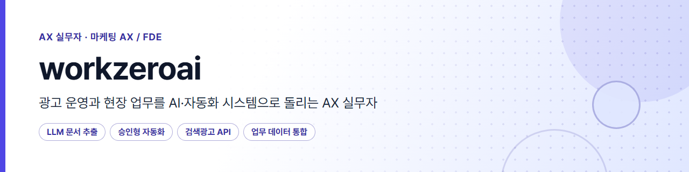
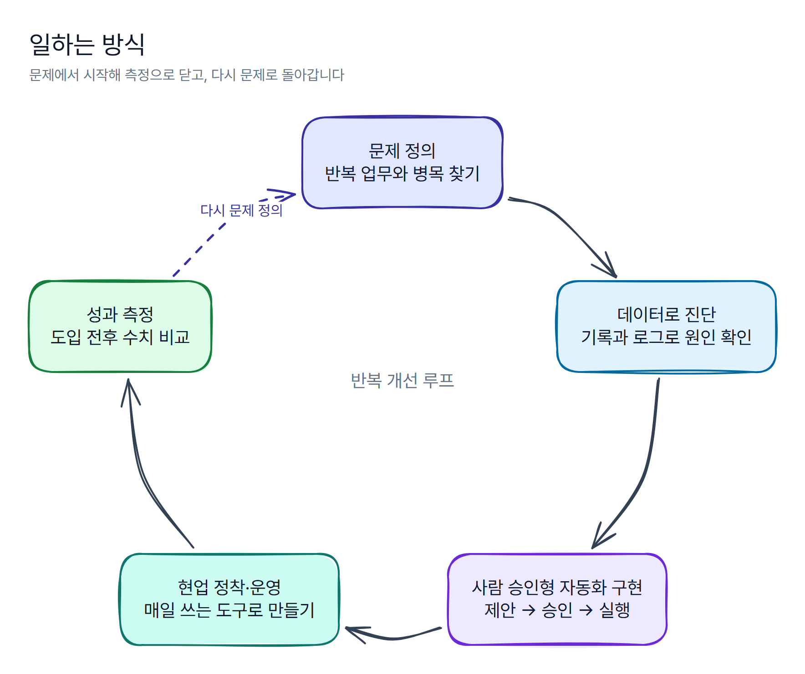

### 광고 운영과 현장 업무를 AI·자동화 시스템으로 돌리는 AX 실무자

An AX practitioner who turns ad operations and field work into AI & automation systems that teams use every day.

- 이전 직장에서 퍼포먼스 마케터로 **월 약 4천만 원 다채널 광고**를 운영했습니다.
- 지금은 개발 조직이 없는 안전관리 전문 기업에서 현업의 반복 업무를 **LLM·API·자동화 시스템**으로 바꾸고, 현업이 매일 쓰도록 운영합니다.
- 자동 실행보다 **사람이 승인하는 자동화**를 기본으로 설계합니다.

#### 회사 운영 결과

| 업무 | 결과 |
|---|---|
| 검색광고 운영 자동화 | 3개 계정, API 반영 37건 실행 오류 0 · 2주 비교 노출 +67%, 평균 노출순위 2.7 → 2.1위 |
| LLM 계약서 PDF 자동 입력 | 약 1,145건 · 건당 1~3분(수기 추정) → 10~15초 |
| 견적 웹 도구 | 3개 사업부 약 2,250건 · 건당 6~24분 → 1~15분(추정) |
| 업무 데이터 통합 | 흩어진 데이터 약 2.2만 건 통합 |

위 수치는 실제 회사 운영 결과입니다. 공개 저장소의 코드와 데모는 같은 설계 아이디어를 가상 데이터로 새로 구현한 것입니다.

## 일하는 방식

  

1. **문제부터 정의한다** — 도구를 고르기 전에 누가, 어디서, 얼마나 자주 막히는지부터 확인합니다.
2. **사람 승인을 기본으로 한다** — 시스템은 제안하고 기록하며, 실행은 사람이 승인한 뒤에만 합니다.
3. **현업이 매일 쓰게 만든다** — 만든 날이 아니라 현업이 매일 쓰기 시작한 날을 완료로 봅니다.

<!--
## 대표 프로젝트
Phase 5(공개 전환)에서 공개된 저장소만 카드로 추가한다. 준비 중인 저장소는 노출하지 않는다.
- ad-ops-approval-engine — 승인형 광고 운영 엔진
- llm-doc-extraction-pipeline — LLM 문서 추출 파이프라인
- airtable-korean-ime-fix — 에어테이블 한글 입력 수정 도구
-->

## 기술

## 연락

- 이메일: [airowoon@gmail.com](mailto:airowoon@gmail.com)
- 노션 포트폴리오: [AX 포트폴리오](https://workzero.notion.site/AX-_-3d312e3c61c981958e60f69a8f6d546e)
